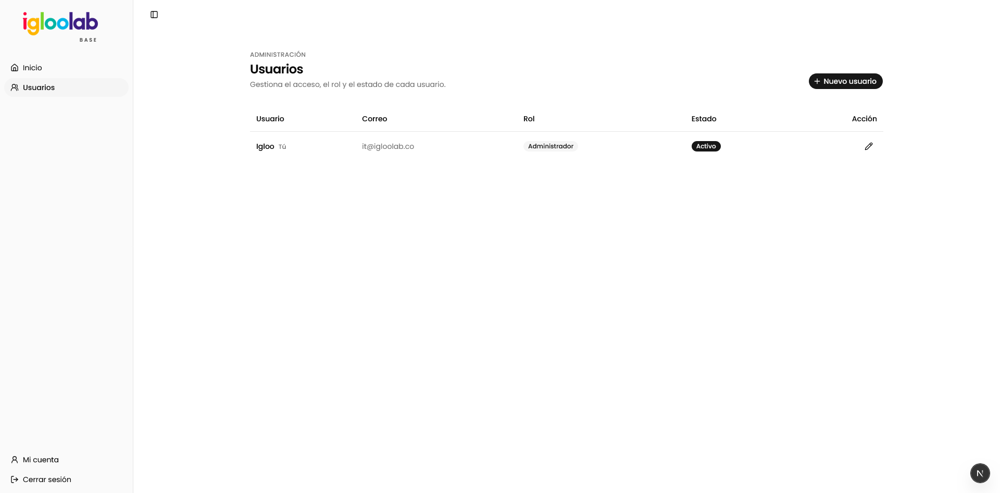

# Base Igloo

Base reutilizable para desarrollar herramientas de Igloo con Next.js, React, TypeScript, Supabase Auth, gestión de usuarios, Tailwind, componentes UI y animaciones.

Recharts está disponible para futuras visualizaciones. Cuando se implemente una gráfica, se puede añadir el componente `Chart` de shadcn según la necesidad concreta.

El código de la aplicación está en `src/` (`app`, `components`, `features`, `hooks`, `lib` y `types`). `public/`, `supabase/` y los archivos de configuración permanecen en la raíz.

## Convenciones para desarrollar

La guía de trabajo para la IA y colaboradores está en [AGENTS.md](AGENTS.md). Para la interfaz, primero reutiliza componentes shadcn instalados; si falta uno, instálalo; crea una pieza propia solo cuando shadcn no cubra la necesidad. Conserva su estilo configurado y evita tarjetas como estructura predeterminada. La lógica de cada función va en `src/features`; los cambios de datos requieren migraciones y comprobaciones de acceso en el servidor.

Las skills locales están en `.agents/skills/`: React/Next.js (Vercel), shadcn, Supabase, PostgreSQL/RLS y revisión de interfaz. `AGENTS.md` indica cuándo usar cada una; `skills-lock.json` registra su origen.

## Desarrollo

1. Instala las dependencias con `pnpm install`.
2. Crea un proyecto **nuevo** de Supabase. Copia `.env.example` a `.env.local` y configura sus credenciales.
3. Aplica **todas** las migraciones de `supabase/migrations/` en orden de nombre. Para una base nueva puedes ejecutarlas en el editor SQL o usar la CLI enlazada a ese proyecto. No uses un proyecto con tablas de otra herramienta.
4. Crea el primer usuario en Supabase Auth y asígnale el rol `admin` con `update public.profiles set role = 'admin' where email = 'tu-correo@ejemplo.com';` en el editor SQL.
5. Inicia con `pnpm dev`.

Incluye login, inicio interno, Mi cuenta y administración de usuarios. Los roles son `admin` y `user`.

En el proyecto alojado, deshabilita el registro público y configura una contraseña mínima de 12 caracteres en Supabase Auth. Configura la URL del sitio para tu despliegue. `supabase/config.toml` define estas opciones para desarrollo local; no configura automáticamente un proyecto alojado.

## Organización

| Ubicación | Responsabilidad |
| --- | --- |
| `src/app` | Rutas, layouts, composición, carga y errores |
| `src/features/auth` | Login, cierre de sesión y cambio de contraseña |
| `src/features/users` | Consulta paginada, acciones y diálogos de usuarios |
| `src/components` | Composiciones compartidas, marca y movimiento |
| `src/components/ui` | Primitivas shadcn; conservar sus archivos originales |
| `src/lib` | Autorización, clientes Supabase y utilidades compartidas |
| `src/types/database.ts` | Contrato TypeScript del esquema SQL |
| `supabase/migrations` | Historial ordenado del esquema, permisos y RLS |
| `supabase/tests` | Comprobaciones SQL con fixtures y rollback |

Las consultas usan el cliente de la sesión y comprueban permisos en el servidor. El cliente administrativo se reserva para gestionar cuentas en Auth. RLS permite leer el perfil propio y, a los administradores activos, los demás perfiles; las escrituras de gestión pasan por una RPC que valida permisos. Los helpers internos viven en el esquema `private`, que no se expone en la API.

Los componentes reutilizables se conservan aunque aún no se utilicen. Recharts, Motion y las primitivas instaladas forman parte de la base; cada herramienta incorpora únicamente las pantallas que necesita.

## Supabase local

Con Docker en ejecución, usa `pnpm exec supabase start` y configura `.env.local` con las claves que muestre la CLI. Para reconstruir **solo la base local desechable**, `pnpm exec supabase db reset` aplica todas las migraciones y borra sus datos anteriores.

Para una nueva migración: `pnpm exec supabase migration new nombre_del_cambio`.

Después de cambiar el esquema, genera el contrato con `pnpm exec supabase gen types --lang typescript --local --schema public` y guarda la salida correctamente como UTF-8 en `src/types/database.ts`. Si falla la generación, conserva el archivo anterior. `UserProfile` y `UserRole` se derivan de ese contrato en `src/types/profiles.ts`.

## Verificación

`pnpm lint`, `pnpm typecheck`, `pnpm test` y `pnpm build`.

Permisos y RLS en Supabase local: `pnpm exec supabase db query --local --file supabase/tests/access.sql`. La prueba crea usuarios de prueba dentro de una transacción y revierte los cambios; no debe ejecutarse contra una base de producción.

Las pruebas de Vitest cubren utilidades y regresiones de sesión. Antes de desplegar, verifica con el Supabase nuevo: login, cierre de sesión, cambio de contraseña, creación/edición de usuarios y rechazo de acceso para usuarios inactivos. Una compilación correcta no sustituye esa integración.
